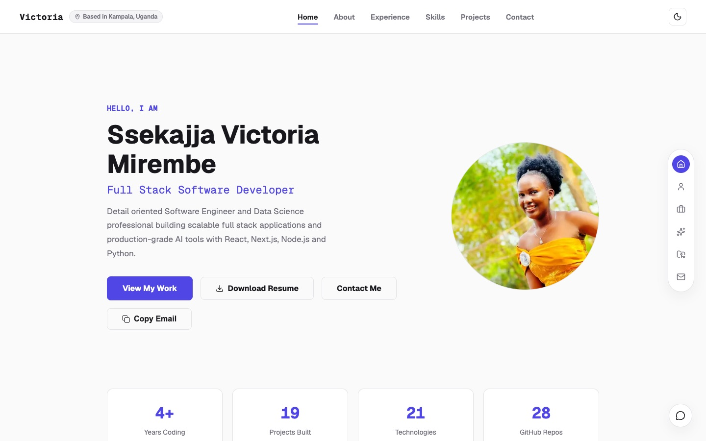

# Ssekajja Victoria Mirembe — Full Stack Software Developer

Detail-oriented Software Engineer and Data Science professional building scalable full stack applications and production-grade AI tools with React, Next.js, Node.js and Python. Based in Kampala, Uganda.

**[🌐 View the live portfolio](https://ssekajja-victoria-mirembe-eta-1237.vercel.app/)** · **[📄 Download my résumé](https://ssekajja-victoria-mirembe-eta-1237.vercel.app/Ssekajja_Victoria_Mirembe_Resume.pdf)** · **[✉️ victoria.ssekajja@gmail.com](mailto:victoria.ssekajja@gmail.com)**

[LinkedIn](https://www.linkedin.com/in/ssekajja-victoria-243216284/) · [GitHub](https://github.com/VictoriaMirembe)



---

## For recruiters and clients

### What I do

| | |
|---|---|
| **Full Stack Web Development** | I design and build responsive web applications end to end, from React and Next.js interfaces to Node.js services, REST APIs and PostgreSQL databases. |
| **AI & LLM Integration** | I integrate Large Language Models such as Claude and OpenAI into products to process text, automate workflows and add intelligent features that solve real problems. |
| **Data & Analytics** | I clean, analyse and visualise data with Python to turn raw datasets into clear, decision-ready insights. |

I also lead development teams and facilitate technical workshops, from coding bootcamps to UI/UX sessions.

### Selected work

| Project | What it is | Built with | Links |
|---|---|---|---|
| **AI Media Lab Platform** | Co-developed an AI-powered innovation ecosystem using LLMs and modern web infrastructure to support fact-checking and modern journalistic workflows. | Next.js, LLMs, AI APIs | [Live](https://aimedialab.africa) |
| **AgriMoist AI** | An AI advisory agent for smallholder farmers in Karamoja, Uganda. It works offline in the field and drafts sourced, plain-language advice that an extension officer approves before it reaches a farmer. | Python, FastAPI, LangGraph | [Live](https://agri-moist-ai.onrender.com/) · [Code](https://github.com/VictoriaMirembe/Agri-moist-AI) |
| **HR-System** | Full-stack HR platform covering onboarding, employee records, leave, attendance, payroll and a self-service portal. | Next.js, PostgreSQL | [Code](https://github.com/VictoriaMirembe/HR-System) |
| **My-POS (Point of Sale)** | Helps small businesses manage day-to-day sales, track inventory and process transactions. | Next.js, TypeScript, Prisma | [Code](https://github.com/VictoriaMirembe/Point-of-Sale) |
| **Vansaac Deep Cleans** | Business website for a cleaning company with services, pricing and a WhatsApp booking flow. | Next.js, React, JavaScript | [Live](https://vansaac-deep-cleans.vercel.app) · [Code](https://github.com/VictoriaMirembe/Vansaac-Deep-Cleans) |

More projects, including a private collaboration platform and work in progress, are on the [live portfolio](https://ssekajja-victoria-mirembe-eta-1237.vercel.app/#projects).

### Experience

- **Junior AI Data Scientist** — Media Challenge Initiative (MCI): co-developed the [AI Media Lab](https://aimedialab.africa) platform, an innovation hub and toolkit equipping journalists and students with AI-powered resources across East Africa.
- **Lead Developer & Student Researcher** — Cavendish University Uganda
- **Class Coordinator / Team Lead** — Faculty of Science and Technology, Cavendish University Uganda
- **President** — Technology Innovators Students Association (TISA), UICT

### Skills

- **Frontend:** HTML5, CSS3, JavaScript, TypeScript, React, Next.js
- **Backend & APIs:** Node.js, REST APIs, Drizzle ORM
- **AI & LLMs:** Anthropic Claude API, OpenAI API
- **Data & Analytics:** Python, Pandas, NumPy, Scikit-learn
- **Databases & Security:** SQL, MySQL, PostgreSQL, bcrypt
- **DevOps:** Git, GitHub, CI/CD pipelines, Contabo VPS hosting

### Education

- Diploma in Data Science Management and Analytics — Uganda Institute of Information and Communication Technology (UICT), 2025 – 2026
- Diploma in Computer Science and Information Technology — Cavendish University Uganda, 2025 – 2026
- National Certificate in Information and Communication Technology, **First Class** — UICT, 2023 – 2024

### Let's work together

I'm available for work and open to opportunities, collaborations and conversations.
Email **[victoria.ssekajja@gmail.com](mailto:victoria.ssekajja@gmail.com)** or connect on **[LinkedIn](https://www.linkedin.com/in/ssekajja-victoria-243216284/)**.

---

## About this codebase

This repository is the source code of the portfolio itself.

### Built with

- **[Next.js 16](https://nextjs.org)** (App Router) and **React 19**
- **TypeScript** for the content data and pages
- **Framer Motion** for scroll animations
- **Anthropic Claude API** for the portfolio assistant chatbot
- **CSS custom properties** for the light and dark themes
- Deployed on **Vercel**

### Highlights

- **One source of truth for content.** Every personal fact (profile, experience, education, projects, skills, contact links) lives in [`app/data/profile.ts`](app/data/profile.ts). The page, the SEO metadata, the social share image and the chatbot all read from it, so they can't contradict each other.
- **AI assistant grounded in real data.** The chatbot's instructions are generated from the same data file, and it is told to answer only from those facts.
- **Stats that stay accurate.** The "Technologies" count is calculated from the Skills section rather than typed by hand.
- **SEO and sharing.** Next.js Metadata API, a generated Open Graph image, JSON-LD structured data, a sitemap and robots rules.
- **Accessibility.** Descriptive alt text, decorative icons hidden from screen readers, semantic lists, and safe external links (`rel="noopener noreferrer"`).
- **Dark mode** that remembers each visitor's choice.

### Run it locally

You need **Node.js 20.9 or newer**.

```bash
git clone https://github.com/VictoriaMirembe/my-portfolio.git
cd my-portfolio
npm install
npm run dev
```

Then open [http://localhost:3000](http://localhost:3000).

The chatbot needs an Anthropic API key. Create a file called `.env.local` in the project root:

```bash
ANTHROPIC_API_KEY=your-key-here
```

The site builds without it; only the chatbot needs the key to answer.

| Command | What it does |
|---|---|
| `npm run dev` | Start the development server |
| `npm run build` | Create a production build |
| `npm run start` | Serve the production build |
| `npm run lint` | Check the code with ESLint |

### Project structure

```
app/
├── data/
│   ├── profile.ts        # All personal content: edit this to update the site
│   └── navigation.ts     # Page sections used by the navbar and side nav
├── components/           # Nav, SideNav, Footer, Chatbot, ThemeToggle
├── api/chat/route.js     # Chatbot endpoint (Claude API)
├── page.tsx              # The single-page portfolio
├── layout.tsx            # Metadata, JSON-LD and site-wide layout
├── opengraph-image.tsx   # Generated social share image
└── globals.css           # Styles and light/dark theme colours
public/
├── projects/             # Project screenshots
└── Ssekajja_Victoria_Mirembe_Resume.pdf
```

### Updating the content

Edit [`app/data/profile.ts`](app/data/profile.ts) and the whole site updates, including the metadata and the chatbot. Run `npm run build` before pushing, because every push to `main` deploys to the live site.

---

© Ssekajja Victoria Mirembe. All rights reserved.
